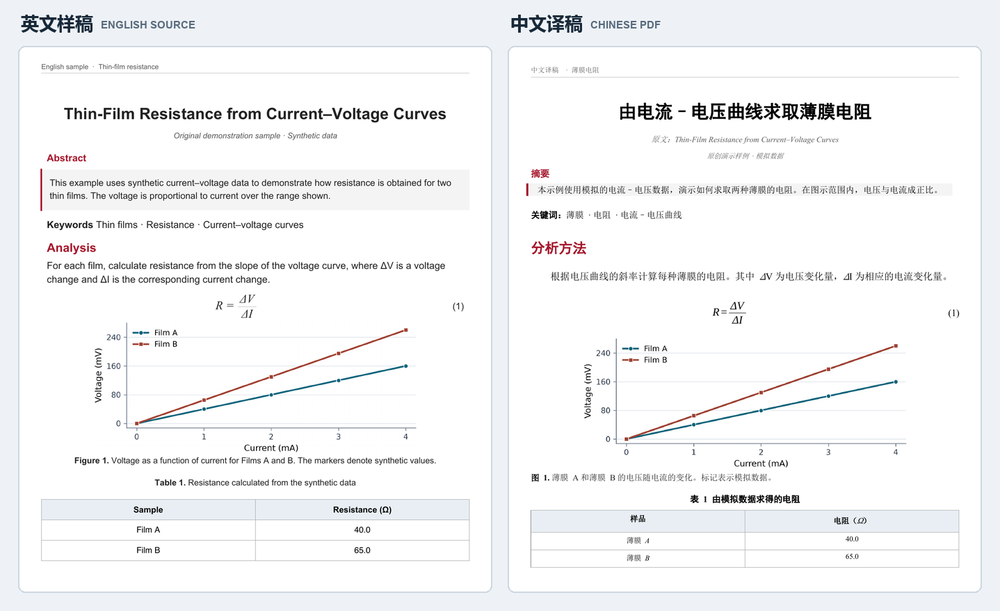

# academic-paper-translation-zh

Translate English academic papers or supporting-information PDFs into a **searchable, typeset Simplified Chinese A4 PDF**, preserving the original figures, captions, equations, tables, and references. The document is rebuilt in Word and then exported to PDF; it is not an image-only translation.

## Example output



The original English sample is on the left. The Chinese A4 PDF exported by this workflow is on the right. The body and caption are translated, the original figure and its English labels are retained, and the equation and table are rebuilt. Text in the exported PDF is searchable and selectable.

## Features

- Full-paper translation with a clean academic layout.
- Separate main-paper and supporting-information PDFs.
- Embedded figures reused at original resolution; vector figures rendered at 300 dpi.
- Equations rebuilt as native Word OMML (editable/selectable) where possible, with PNG fallback; native Word tables; English references preserved.
- Page headers/footers, Chinese captions, and a validated visual pass.

## Install

```bash
mkdir -p ~/.dsh/skills
git clone https://github.com/Andre8726/academic-paper-translation-zh.git \
  ~/.dsh/skills/academic-paper-translation-zh
```

Then invoke:

```text
Use academic-paper-translation-zh to translate these PDFs into Chinese PDFs, keeping figures, equations, and tables.
```

## Requirements

Python 3.9+, PyMuPDF, python-docx, matplotlib, Pillow, and the DSH LibreOffice Kit (`office-export-pdf` / `office-render`).

See [SKILL.md](SKILL.md) for the full workflow and [translation-style.md](references/translation-style.md) for terminology and layout rules.
